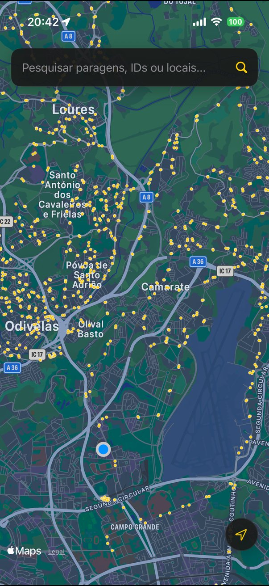
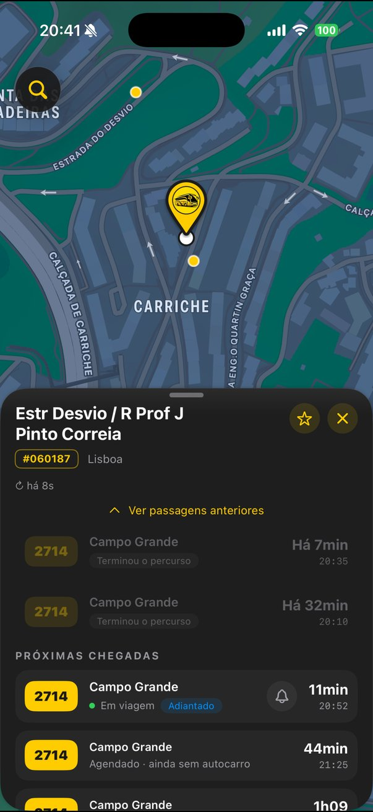
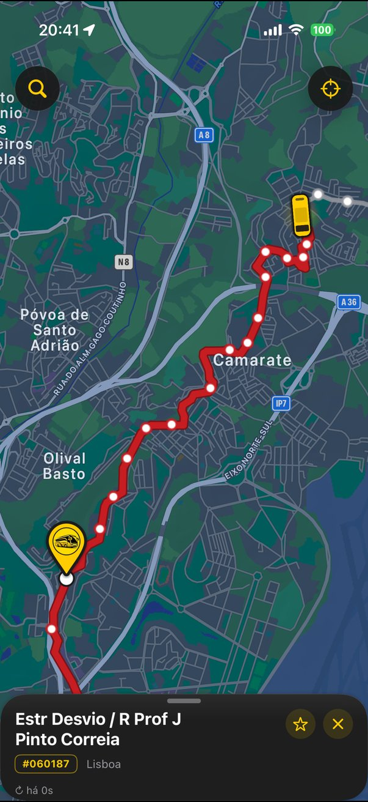
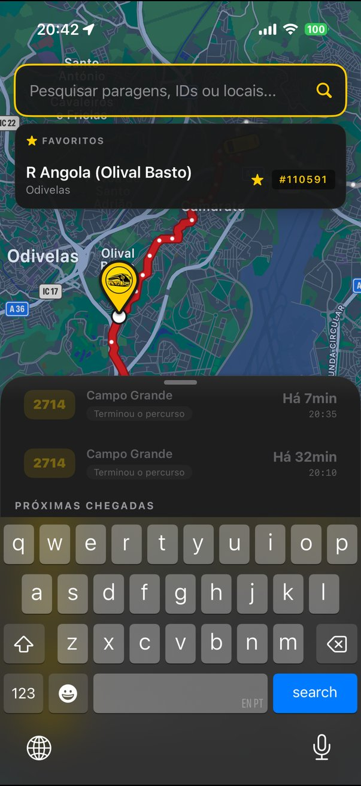
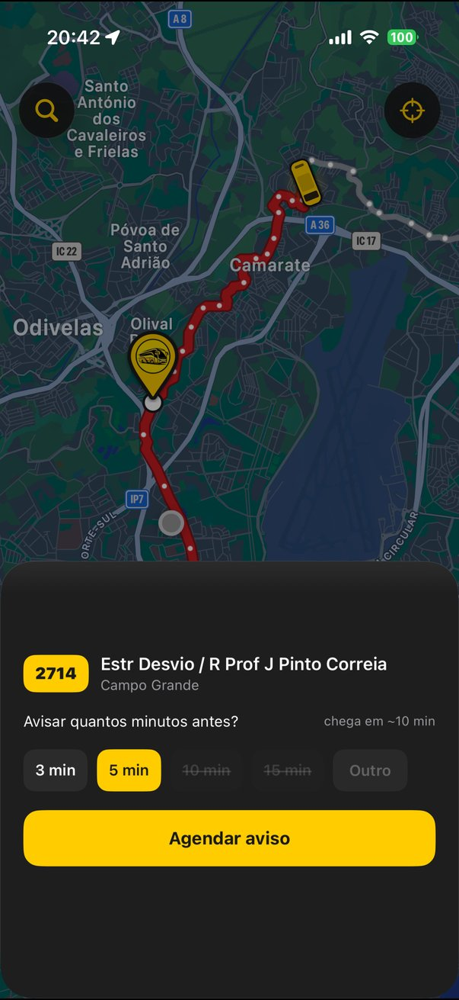

# Bus Lisbon for iOS

The native iPhone version of [Bus Lisbon](https://github.com/KennedySilva8907/Bus-Lisbon). Pick a stop anywhere in the Carris Metropolitana network, see what's coming, and follow the bus on the map until it gets to you.

Written in Swift and SwiftUI. I built it on Windows with [xtool](https://github.com/xtool-org/xtool) in WSL, without a Mac.

| Map | Stop | Following a bus | Favourites | Alert |
|:---:|:---:|:---:|:---:|:---:|
|  |  |  |  |  |

## What it does

- **Every stop on the map.** All ~12,700 stops, drawn as one MapKit overlay so the map stays smooth. They're cached on the phone for a day.
- **Search** by name, stop number or place, offline, with Portuguese accents folded (`sao sebastiao` finds São Sebastião). Swipe the bar left to tuck it into a button.
- **Stop panel** with the next arrivals from the backend, refreshed every 15 seconds. Live buses show how early or late they are, and the ones that already went by sit under "Ver passagens anteriores".
- **Follow a bus.** Tap a live arrival and the map follows it. The bus slides along the road, the route is grey behind it and in the line colour ahead, and the map keeps the bus and your stop in view.
- **Favourites.** Star a stop in its panel. Favourites show up in the search bar when it's empty, and a swipe removes one.
- **Alerts.** Tap the bell on a live arrival to get a notification 3, 5, 10 or 15 minutes before it gets there. Tapping the notification opens the stop with that bus being followed.
- Small animations here and there (the pin drops in, the countdown rolls, rows slide to the past). All of them turn off with Reduce Motion.

## How it's put together

Two Swift packages, so the logic can be tested on Linux without SwiftUI getting in the way.

**`BusLisbonCore`** is plain Swift. It has the models, the API client and all the rules: which positions to trust, how to place a bus and the stops along a route shape, the countdown labels, the search index, the alert timing. The client takes its transport as a function, so it never touches `URLSession` and the tests don't need a network. 174 tests with Swift Testing. Many of them are cases ported from the web app's own tests.

**`BusLisbon`** is the SwiftUI app. The map is an `MKMapView` inside a `UIViewRepresentable`, with the stops, the route and the arrows drawn as overlays. Every screen has its own `@Observable` model, and polling lives in `.task` so it stops when the screen closes.

Where the data comes from:

| What | From | How often |
|---|---|---|
| Stops | Carris Metropolitana `/stops` | once a day, kept on the phone |
| Arrivals | Bus Lisbon backend `/api/arrivals/by-stop/{id}` | every 15 s while a stop is open |
| The bus you follow | Bus Lisbon backend `/api/vehicles/{id}` | every 8 s while following |
| Route shape | Carris Metropolitana `/patterns` and `/shapes` | once per route, kept on the phone |
| Fallback | Carris Metropolitana `/v2/vehicles` | only when the backend doesn't answer |

The backend is the .NET API from the Bus Lisbon repository. The iOS app doesn't need any keys.

## Running it

You need xtool set up with a Swift 6 toolchain and the Darwin SDK. A free Apple account is enough.

```bash
cd BusLisbonCore && swift test     # the core tests, works on Linux

cd ../BusLisbon && xtool dev       # builds and installs on a connected iPhone
```

The app targets iOS 17.

## CI

GitHub Actions runs the core tests on Ubuntu and builds the app for iOS on macOS, on every pull request and on every push to `main`.

## Limits

- With a free Apple account the app expires after 7 days and needs `xtool dev` again. Nothing on the phone is lost.
- There are no push notifications without the paid developer programme, so alerts are local notifications. While the app is open the alert time follows the estimate. With the app closed iOS only wakes it now and then, so a bus that gets late after you close the app can make the alert go off early.
- The line reliability ranking from the web app isn't in the iOS app yet.

## Licence

MIT, see [LICENSE](LICENSE).
